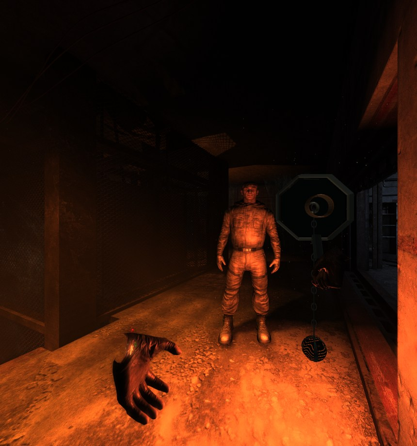

> [!IMPORTANT]
> **💬 DOWNLOAD & DISCUSSION**
>
> **[Join the Flat2VR Discord](https://discord.gg/P4q9zt7ek)** · **[Open the Metro 2033 (2010) thread](https://discord.com/channels/747967102895390741/1550743551711645746)**
>
> Get the mod and share feedback in the game’s Flat2VR thread.

  

## 📦 INSTALLATION

1. Install the original **Metro 2033** on PC.
2. Extract the full mod folder from the Metro 2033 Discord thread.
3. Connect PC VR, select your OpenXR runtime, and run **`RUN.bat`**.

## ⚡ FEATURES

### LIFT AN ENEMY WITH ONE HAND

Use telekinesis to hold an enemy with your left hand while you switch weapons with the other.

### SHOCK ENEMIES WITH YOUR HAND

Cast lightning to damage and push a target.

### LAND A HIT WITH THE BLADE ITSELF

Swing your tracked blade into an enemy to deal contact damage.

## 📸 In-game screenshots

  
  

[Tester credits](TESTERS.md)

## 🎮 Other VR mods

| VR mod | Highlights |
| --- | --- |
| [Alone in the Dark (2008) VR](https://github.com/Monsterdeadwood/AloneInTheDark2008VR) | Tracked item handling and hand contact with walls |
| [Battlefield 3: VRevamp](https://github.com/Monsterdeadwood/Battlefield-3-VRevamp) | Body holsters, two-handed aiming, and changing campaign skies |
| [Burnout Paradise Remastered VR](https://github.com/Monsterdeadwood/BUrnOutPvr) | Head-tracked driving with stereo boost and exhaust effects |
| [Crysis 2: VRevamp](https://github.com/Monsterdeadwood/C2VR) | Telekinesis, switchable weapon hands, and randomized weather and time of day |
| [NOVA · CS:GO Legacy VR](https://github.com/Monsterdeadwood/CSGOVR) | Controller aiming and working optics in local bot matches |
| [Rainbow Six Siege VR](https://github.com/Monsterdeadwood/SiegeVR) | Tracked weapons and two-handed foregrip handling |
| [Star Wars: The Force Unleashed II VR](https://github.com/Monsterdeadwood/TFU2VR) | Independent sabers, limb cuts, Force powers, and crate flight |
| [TimeShift VR](https://github.com/Monsterdeadwood/TimeShiftVR) | Randomized weather, day and night, and roomscale crouching |
| [Titanfall 1 VR](https://github.com/Monsterdeadwood/Titanfall1VR) | Aim with the controller and look around a Titan cockpit |
| [You Are Empty: Absolute Edition VR](https://github.com/Monsterdeadwood/YouAreEmptyAEVR) | Tracked weapons and melee with either hand |
