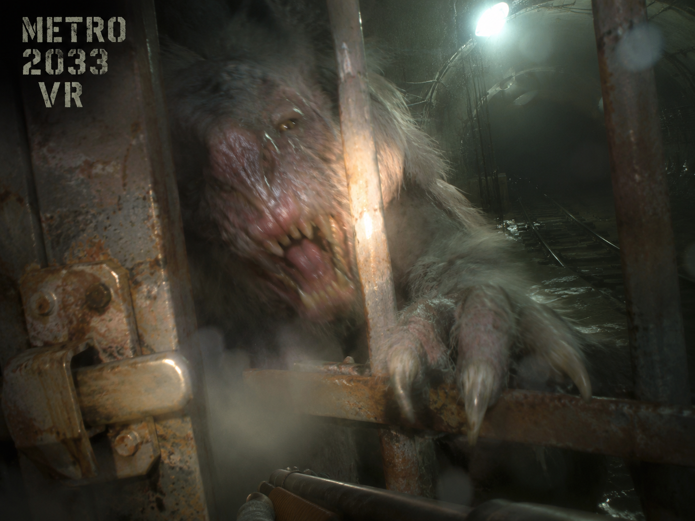

> [!IMPORTANT]
> **TEST BUILDS & DISCUSSION**
>
> **[Join the Flat2VR Discord](https://discord.gg/P4q9zt7ek)** · **[Open the Metro 2033 (2010) thread](https://discord.com/channels/747967102895390741/1550743551711645746)**
>
> Download the latest test build from the thread and share your results there.

  

## INSTALLATION

1. Install the original **Metro 2033** and arrange a test for that exact build in Flat2VR.
2. Extract the full mod folder supplied for the experiment.
3. Connect PC VR, select your OpenXR runtime and run the supplied **`RUN.bat`**.

## FEATURES

### TELEKINESIS & LIGHTNING

Hold an enemy with your left hand while you change weapons. Release them back into the game’s AI, or shock a target with real damage and physical force in a separate test.

### BLADE DAMAGE BY CONTACT

A tracked blade dealt damage when it physically touched a test enemy, without a trigger press.

### A POWERED CORE LIGHTS THE WORLD

The core heats up, casts light on the scene and physically rebounds off walls in its own test build.

Each feature comes from a separate local prototype. These tests target Metro 2033 Original.

[Other VR mods](PORTFOLIO.md) · [Tester credits](TESTERS.md) · [Build details](docs/PROJECT_STATUS.md)
