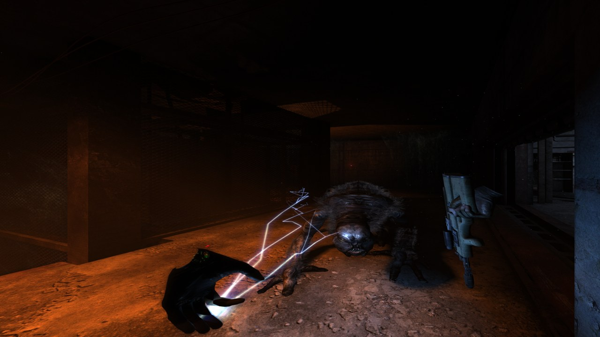

> [!IMPORTANT]
> **DOWNLOAD & DISCUSSION**
>
> **[Join the Flat2VR Discord](https://discord.gg/P4q9zt7ek)** · **[Open the Metro 2033 (2010) thread](https://discord.com/channels/747967102895390741/1550743551711645746)**
>
> Get the mod and share feedback in the game’s Flat2VR thread.

  

## Features

**Stereo VR · Left-hand telekinesis · Lightning · Tracked blade strikes · Throwable power cores**

###  Lift an enemy with one hand and keep the other free

Hold a target up with your left hand while you switch weapons with the other, then let them go when you’re ready.

###  Shock an enemy and knock them back

Send lightning from your hand to damage and push a target.

###  Land a blade strike by making contact

Swing the tracked blade into an enemy. The blade deals damage when it connects.

###  Bounce a glowing power core off the tunnel walls

Throw the core down a corridor. It casts light on the surroundings and ricochets off hard surfaces.

## Installation

1. Install the original **Metro 2033** on PC.
2. **Put the mod archive next to the game’s `.exe`.** Extract the complete archive there and keep the mod folder intact.
3. Connect PC VR, select your OpenXR runtime, and run **`RUN.bat`** from the extracted mod folder.

## In-game screenshots

  
  

[Tester credits](TESTERS.md)

## Other VR mods

| VR mod | Highlights |
| --- | --- |
| [Alone in the Dark (2008) VR](https://github.com/Monsterdeadwood/AloneInTheDark2008VR) | Sweep a flashlight across the room, then grab a chair and carry it by hand. |
| [Battlefield 3: VRevamp](https://github.com/Monsterdeadwood/Battlefield-3-VRevamp) | Pull a dropped enemy rifle toward you, take it with your other hand and fire. |
| [Burnout Paradise Remastered VR](https://github.com/Monsterdeadwood/BUrnOutPvr) | Look into a corner, drift through it and hit boost as you straighten out. |
| [Crysis 2: VRevamp](https://github.com/Monsterdeadwood/C2VR) | Lift an enemy with your free hand and fling them across the room with a swing. |
| [NOVA · CS:GO Legacy VR](https://github.com/Monsterdeadwood/CSGOVR) | Bring the AWP’s scope up to your eye and feel the kick when you shoot. |
| [Rainbow Six Siege VR](https://github.com/Monsterdeadwood/SiegeVR) | Reach for the rifle’s foregrip and steer the muzzle with both hands. |
| [Star Wars: The Force Unleashed II VR](https://github.com/Monsterdeadwood/TFU2VR) | Hold a Stormtrooper in the air with the Force and swing a lightsaber with your other hand. |
| [TimeShift VR](https://github.com/Monsterdeadwood/TimeShiftVR) | Let go of the foregrip for a quick punch, or strike with the rifle itself. |
| [Titanfall 1 VR](https://github.com/Monsterdeadwood/Titanfall1VR) | Call down a Titan, climb in and send captured shots back with the Vortex Shield. |
| [You Are Empty: Absolute Edition VR](https://github.com/Monsterdeadwood/YouAreEmptyAEVR) | Keep your gun trained ahead with your right hand and strike with your free left. |
