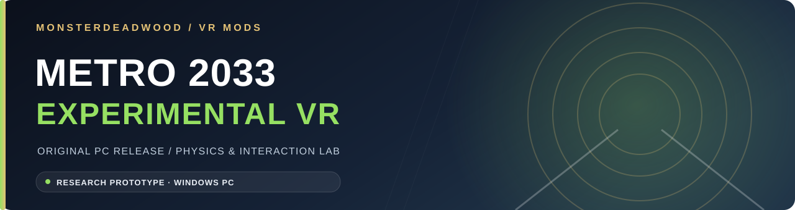

> [!IMPORTANT]
> **[ТЕСТИРОВАНИЕ И ОБСУЖДЕНИЕ · FLAT2VR DISCORD](https://discord.gg/P4q9zt7ek)**
> Тестирование, запрос сборок, отзывы и обсуждение проходят в **Flat2VR Modding Discord**. Перейди на сервер и найди тему **Metro 2033 VR**.

# Metro 2033 VR

[English](README.md) · [Русский](README_RU.md) · [Flat2VR Discord](https://discord.gg/P4q9zt7ek) · [All projects](PORTFOLIO.md)

Экспериментальный проект VR и взаимодействий для оригинальной PC-версии Metro 2033. Локальная работа исследует взаимодействие от контроллеров, родные тела PhysX, полёт предметов, освещение и реакции врагов.

**Текущая описанная ветка: Original Metro 2033 / local interaction branches.**

## Установка

1. Согласуй тест **Metro 2033 Original** в теме игры на Flat2VR. Текущие физические ветки — исследовательские прототипы.
2. Используй точную версию игры и полную папку, выданную для конкретного эксперимента. Redux — отдельная цель.
3. Подключи указанную для теста среду PC VR/OpenXR и запусти приложенный **RUN.bat**.
4. Следуй управлению конкретного сценария и отправь журналы/видео в тему Discord.

Доступность актуальных тестовых пакетов уточняется в Discord. Нужен полный пакет для поддерживаемой версии игры; страница проекта сама по себе не является скачиваемым релизом.

## Что есть в проекте

- VR-интеграция оригинальной игры и исследование взаимодействий от контроллеров.
- Эксперимент реального контакта ракетки и динамического тела PhysX с полётом и отскоками от стен.
- Нагрев/остывание активного ядра и реальный свет на окружении.
- Отдельные опыты с родными ударом, падением и восстановлением проверенного вооружённого человека.

<b>Краткое управление</b>

| Действие / кнопка | Назначение |
| --- | --- |
| Supplied experiment controls | Раскладка конкретной экспериментальной ветки |
| Grip in the powered-core flight experiment | Запросить возврат экспериментального объекта |

Полная инструкция управления в конкретной сборке учитывает её версию и профиль контроллеров.

## Текущий статус

**Исследовательский прототип.** Ветка активного ядра записала нативный полёт, семь статических отскоков, возврат и очистку в настоящей игре через XR Sim; отдельно пройден повтор холодного запуска.

- Эти эксперименты не подтверждают полностью игровую кампанию и принятие в физическом шлеме.
- Все враги/мутанты, вооружённая поза после слабого удара, вся геометрия коллизии и звук/ощущения ещё требуют работы.

Физические ветки и реакции врагов сохраняют собственные области проверки; результаты разных прогонов не выдаются за одну завершённую сборку.

[Подробный статус и область проверки](docs/PROJECT_STATUS.md)

## Тестирование и отзывы

Напиши в [тему игры на Flat2VR](https://discord.gg/P4q9zt7ek): укажи **версию мода, игру/магазин, шлем, OpenXR runtime, GPU, шаги воспроизведения и диагностический ZIP сборки**. Для проблем изображения или управления полезно короткое видео.

## Другие мои VR-моды

| Игра / проект | Направление | Доступ |
| --- | --- | --- |
| [Battlefield 3 VR](https://github.com/Monsterdeadwood/BF3VR) | Кампания, оружие и руки | Закрытый |
| [Assassin’s Creed VR](https://github.com/Monsterdeadwood/AC1VR) | Обзор от первого лица, лазание и меч | Закрытый |
| [Crysis 2 VR](https://github.com/Monsterdeadwood/C2VR) | Нанокостюм, физическое взаимодействие и интерфейс | Закрытый |
| [NOVA · CS:GO Legacy VR](https://github.com/Monsterdeadwood/CSGOVR) | Локальные матчи CS:GO Legacy с VR-управлением | Закрытый |
| [TimeShift VR](https://github.com/Monsterdeadwood/TimeShiftVR) | Управление временем, девять видов оружия и позы | Закрытый |
| [You Are Empty: Absolute Edition VR](https://github.com/Monsterdeadwood/YouAreEmptyAEVR) | Absolute Edition в VR, оружие и взаимодействие | Открытый |
| [Alone in the Dark 2008 VR](https://github.com/Monsterdeadwood/AloneInTheDark2008VR) | VR-хоррор и взаимодействие с предметами | Открытый |
| [Rainbow Six Siege VR](https://github.com/Monsterdeadwood/SiegeVR) | Стерео и оружие от контроллеров в старой Siege | Открытый |
| [Burnout Paradise Remastered VR](https://github.com/Monsterdeadwood/BUrnOutPvr) | Стереовождение, меню автомобилей и эффекты | Закрытый |
| [Titanfall 1 VR](https://github.com/Monsterdeadwood/Titanfall1VR) | Бой пилота и кабины титанов | Закрытый |
| [Insurgency VR](https://github.com/Monsterdeadwood/InsurgencyVR) | Начальная подготовка VR-интеграции | Закрытый |
| [Counter-Strike: Source VR](https://github.com/Monsterdeadwood/CSSVR) | Разработка VR для Counter-Strike: Source | Закрытый |

Ссылки на закрытые репозитории доступны приглашённым участникам. Открытые страницы отмечены в таблице.

## Авторство и заметки разработки

Проект ведёт [Monsterdeadwood](https://github.com/Monsterdeadwood). Это независимый фанатский VR-проект; нужна собственная поддерживаемая копия оригинальной игры.

Описание сверено: **14 ноября 2026 года**.
